# PROJECT AKHET

A fully procedural, real-time reconstruction of the **Giza plateau c. 2550 BCE** —
the moment the Great Pyramid stands newly cased and the site around it is still a
working construction yard.

No modelled assets. No photographs. No textures shipped with the build. Every
stone, dune, palm, boat and person in the frame is generated from code and
survey dimensions at load time, and rendered with WebGPU (three.js `WebGPURenderer`
+ TSL + WGSL compute).

```bash
npm install
npm run dev          # http://localhost:5173
```

Requires a current Chromium with WebGPU. There is no WebGL fallback — that is a
design decision, not an omission (see *Hard rules*).

---

## Gallery

Every frame below is rendered live by `npx tsx tools/gallery.ts` (one boot, no
post-processing outside the engine) and committed to `docs/gallery/`.

**Dawn from the harbour** — the two-frame test, first half. The basin catches the
sky, the causeway climbs to the plateau, the pyramid trio takes the first warm
light.

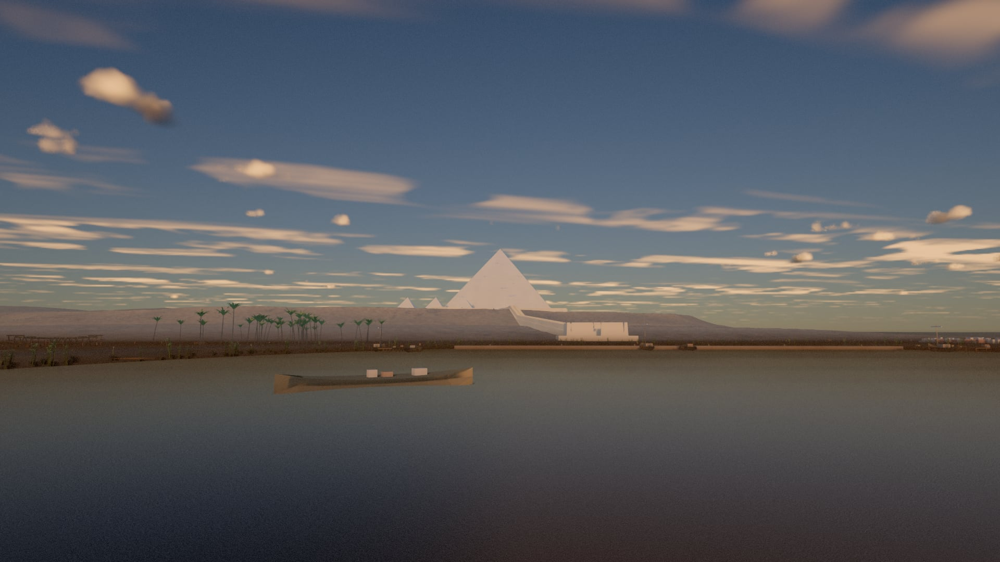

**Noon on the plateau** — the two-frame test, second half. Brutal near-neutral
light, dense blue zenith, and the casing reading distinctly brighter than the
desert it stands on (see *The chalkiness fix* below for why that sentence is the
whole point).

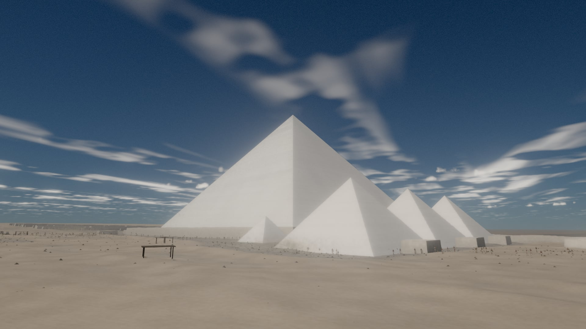

**The harbour** — storage magazines and a granary on the north shore, the
basin, the valley temple and the causeway climbing to the pyramids.

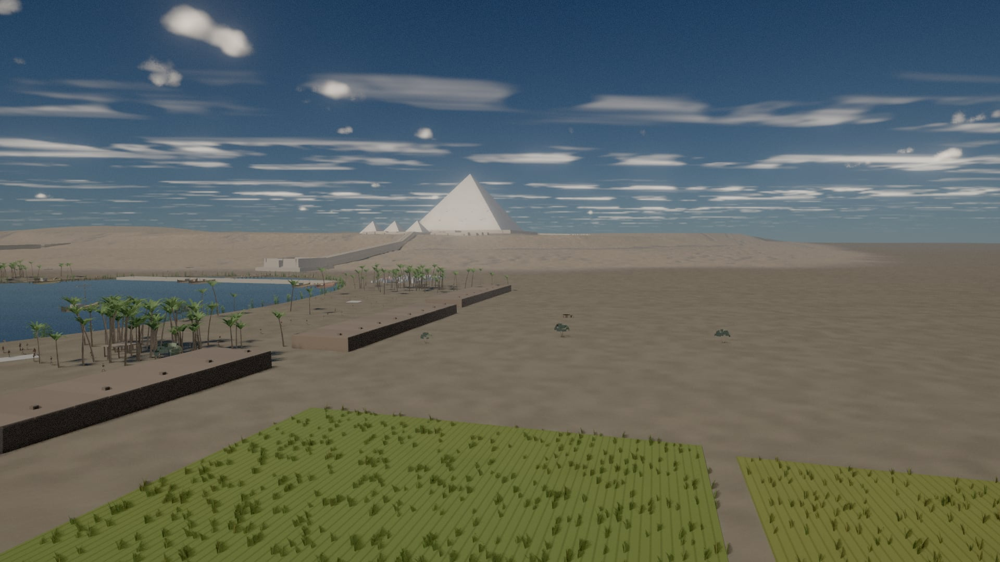

**The boatyard** — hulls on their stocks still held by the moulds, cedar baulks
cross-stacked to season, a saw frame, and the gangs who work there.

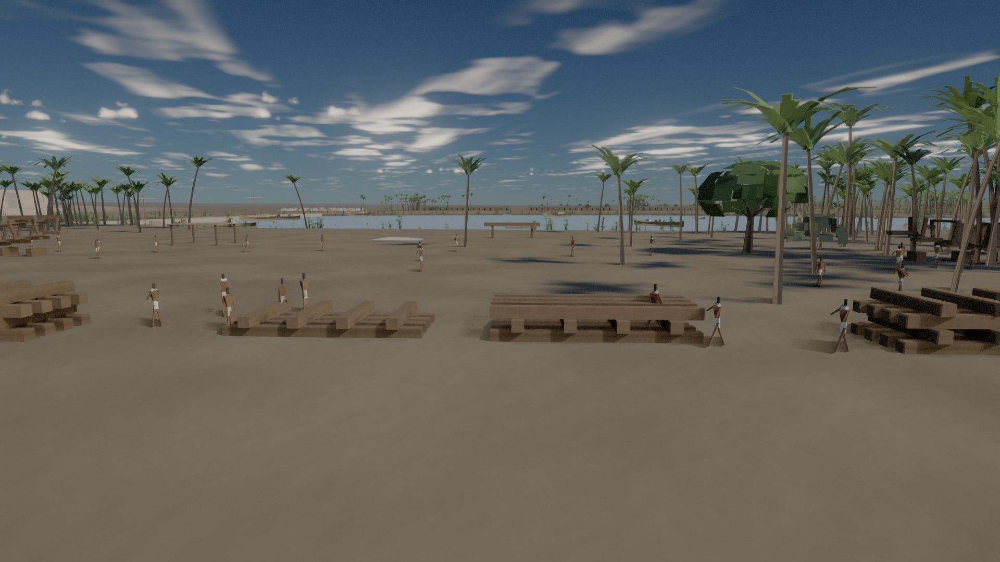

**The queens' pyramids and the mortuary temple** — the basalt court, the
falsework on the temple's unfinished corner, the eastern cemetery beyond.

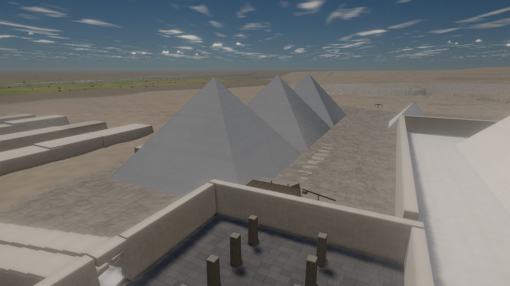

**Construction tableau** — timber falsework, a lever crane and a rubble ramp on
the temple's south-east corner, late afternoon.

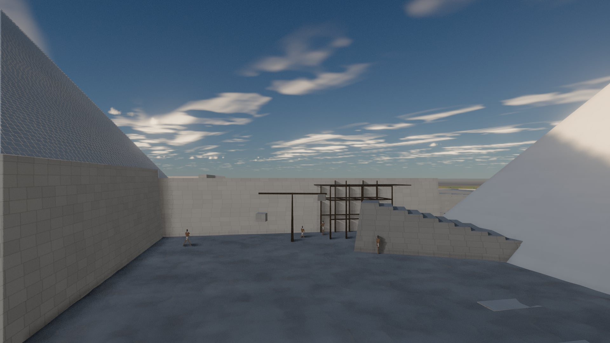

**Heit el-Ghurab** — the workers' town on its levelled terraces: gallery blocks
with street porticos, the eastern town, bakeries, and the Wall of the Crow
stepping down the slope.

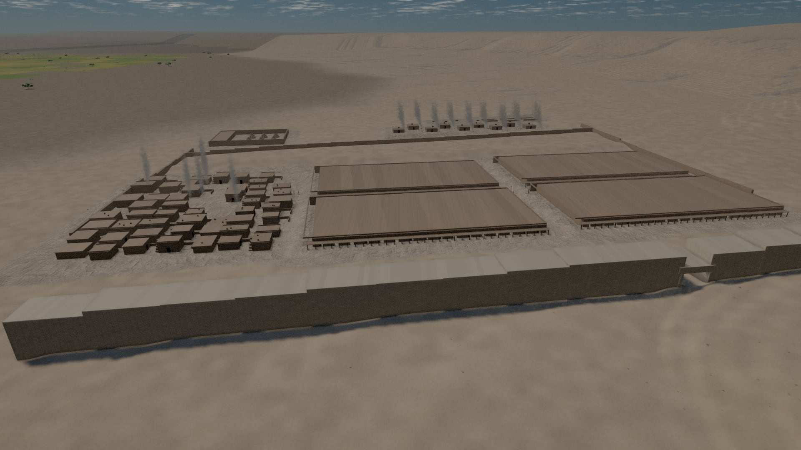

**The Nile bank** — papyrus in the shallows, palms and field margins on a bank
that slumps and scours rather than running ruled-straight.

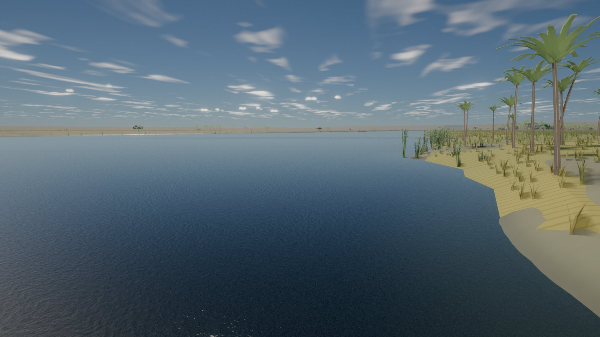

**Night** — analytic stars and a phase-shaded moon; the town's torches and bakery
hearths carry the "someone is home" read, and the moon takes over the sun's own
directional light so shadows keep working after dusk.

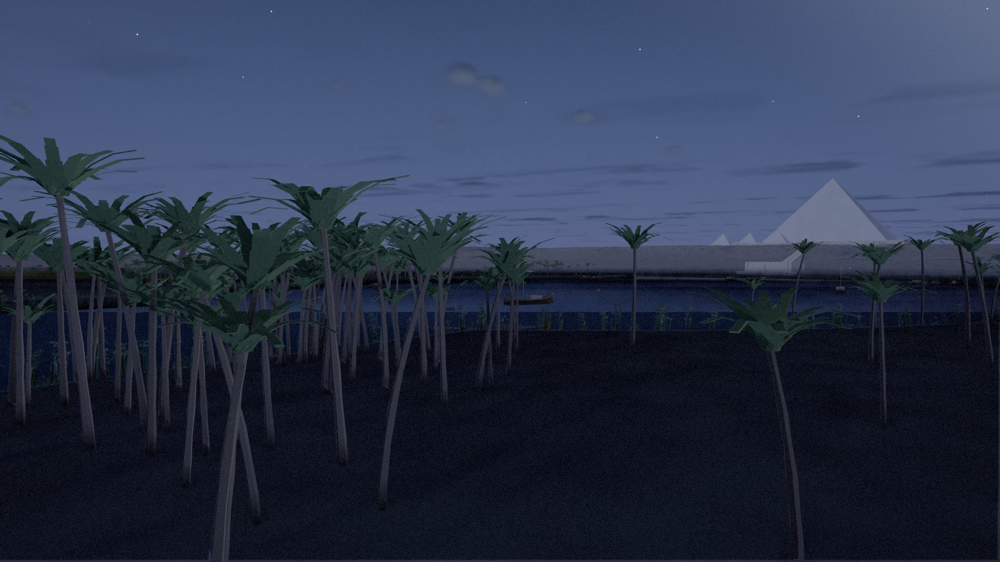

---

## What is in the world

| System | What it generates |
| --- | --- |
| **Heightfield** | 4096² authored geography — tilted Mokattam plateau, escarpment polyline, Main Wadi, Khufu quarry with 1.12 m lifts, floodplain, Nile channel + harbour basin; GPU sand transport (saltation + repose + diffusion) |
| **Terrain** | CDLOD quadtree of instanced patches, morphing + skirted, 5-family splat, micro-displacement, far vista shell |
| **Monuments** | Pure course solver (Petrie sawtooth profile, 210 courses normalised to survey height) driving 63k instanced chamfered casing stones for G1 + queens + satellite, with a silhouette-true backing pyramid as far LOD |
| **Khufu complex** | Court pavement as ~17k individual slabs, temenos wall, mortuary temple, walled and roofed causeway on its embankment, valley temple, boat pits, ~400 mastabas in two cemeteries |
| **Worker town** | Gallery blocks with street porticos and real doorways, eastern town, bakery rows, Royal Administrative Building with beehive silos, Wall of the Crow — each district on its own levelled terrace |
| **Harbour district** | Storage magazines, a beehive-silo granary, a stone yard of dressed casing blocks and Aswan granite, cargo slipways, a boatyard with hulls on stocks, wells |
| **Water** | Flow-advected ripple normals, true sky reflection, depth absorption over the sampled bed, low-sun glint |
| **Life** | 5.4k palms · 750k field tufts in 754 parcels · 3.5k shore clumps · 380 trees · 84k debris chips · 131k work particles · ~880 working figures · ox sledge trains |
| **Sky** | Hillaire LUT atmosphere (dry-desert Mie + dust layer), raymarched cumulus, cirrus deck, analytic stars/Milky Way/moon |
| **Light** | 256²×6 terrain-relative SH probe GI with an analytic ray–pyramid intersector (the casing is a bounce source), CSM + PCSS + contact shadows, GTAO, screen-space bounce, froxel volumetrics, TRAA, per-ToD colour script |

---

## Controls

| Key | Action |
| --- | --- |
| `W A S D` `Q E` | Fly (mouse look after clicking the canvas) |
| `Shift` | Sprint |
| `G` | **Walk mode** — eye height 1.55 m, pinned to terrain *and* structures |
| `1`–`9`, `0`, `-` | Bookmarks (`0` = night harbour, `-` = temple scaffolding; both also set the hour) |
| `F` | Cinematic flythrough |
| `[` `]` | Step time of day |
| `E` | Placement inspector |
| `P` | Print the camera pose string |

Useful URL parameters: `?T=` hour · `?bm=` bookmark · `?preset=safe|low|high|ultra` ·
`?cam=x,y,z,yaw,pitch` · `?freeze=1` · `?cull=0` · `?prepass=1` · `?froxels=0` ·
`?cirrus=N` · `?fog=N` · `?dust=N` · `?walk=1` · `?hud=1` · `?band=N` · `?force=1`

---

## Verification

Claims in this project are expected to come with numbers.

```bash
npm run battery                 # the full gate: audits, floors, walk mode, tone, perf
npx tsx tools/shoot.ts --scene world --T 12.4 --bm 3 --out shots/x.png
npx tsx tools/levels.ts --in shots/x.png --box "casing:620,450,760,560"
npx tsx tools/diff.ts --a a.png --b b.png --out d.png
npx tsx tools/probe-igpu.ts      # the integrated-GPU perf sweep
npx tsx tools/probe-igpu-boot.ts # TDR/device-loss gate on a slow adapter
```

* `tools/audit.ts` — canon/spec consistency, course count, sun cardinality, a
  rendered-shadow azimuth check, and a headless collision audit.
* `tools/levels.ts` — clipping, percentiles and patch means. This is the
  instrument the colour work argues with.
* `tools/diff.ts` — mean/p99/max plus the share of pixels over ±2/±8/±24, for
  "this refactor changed nothing" claims.
* `tools/battery.ts` — runs all of the above plus the content floors from the
  brief and a 1440p perf sweep.

### The chalkiness fix

Worth singling out, because it is the shape of every good finding in this build.
"Midday reads chalky" was a note for months. Measured, it became exact: at T 12.4
the sunlit desert had luminance **194.9** against the Tura casing's **198.1** — a
**1.6 %** separation. The Great Pyramid and the sand it stands on were the same
tone, and no amount of grading could fix that, because it was an albedo error
(sand 0.80 where dry desert sand is 0.35–0.45). With physical values the same
measurement reads **149.9 vs 198.5**.

| before | after |
| --- | --- |
| 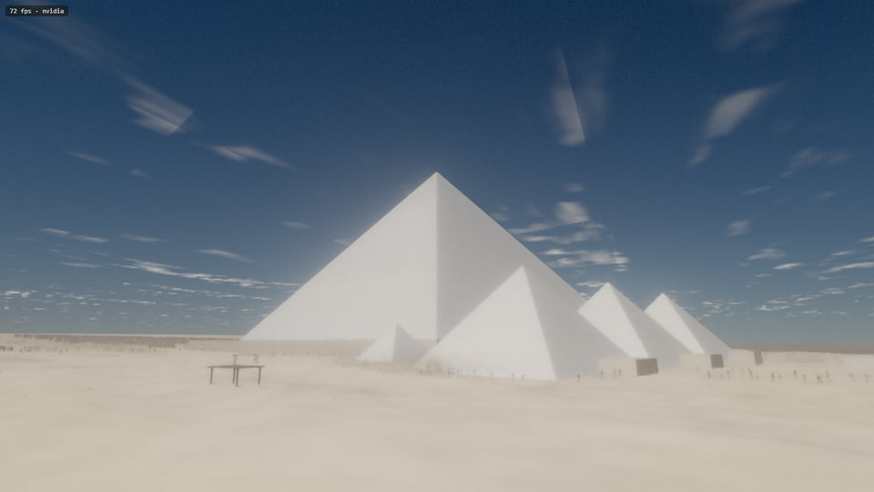 | 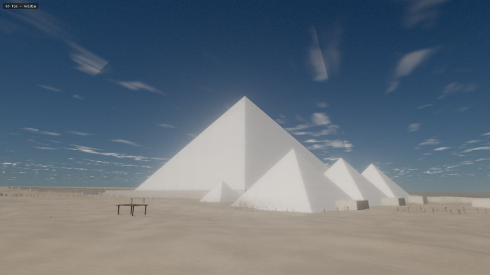 |

---

## Performance

Measured on the development machine — an **RTX 3050 Laptop 4 GB**, which is
*below* the RTX-3060-class target in the brief. Numbers are honest for this GPU,
not extrapolated.

| Framing @ 2560×1440 | Before PERF I | After |
| --- | --- | --- |
| Harbour panorama | 27.4 ms | **17.2 ms** |
| Noon court | 25.7 ms | **13.7 ms** |
| Quarry (heaviest) | 34.1 ms | **21.0 ms** |

Scatter systems are bucketed into spatial cells at build time and drawn with
**WebGPU indirect draws** — one indirect entry per cell, `firstInstance` at the
slice start — while the CPU rewrites `geometry.indirectOffset` from the frustum
each frame. Shadow-casting systems union their own sun-projected footprint into
the test, so a grove behind the camera keeps the shadow it throws into view.

A reduced preset (`?preset=low`, engaged automatically on an integrated GPU)
trades render scale, tile budget, GI cadence and cascade count rather than
dropping whole systems.

---

## Running on the right GPU

On a laptop with switchable graphics, Chrome will hand the page the **Intel
iGPU** by default and there is nothing the page can do about it —
`powerPreference: 'high-performance'` is ignored on Windows
([crbug 369219127](https://crbug.com/369219127)). AKHET detects it, drops to the
reduced preset, and says so in an on-screen notice. To get the discrete GPU:

* **Windows** → Settings → System → Display → Graphics → browse for your
  browser → Options → **High performance** → Save, then restart the browser.
* **NVIDIA Control Panel** → Manage 3D settings → Program Settings → add the
  browser → *High-performance NVIDIA processor*.
* Or launch the browser once with `--force_high_performance_gpu`.

AKHET does not trust the vendor string for this. At boot it times a fixed GPU
workload at two sizes and takes the slope — measured **0.4–1.4 ns per
invocation on an RTX 3050 Laptop against 5.2–22 ns on an Intel UHD** — and
caps the preset from that number (`src/core/GpuBench.ts`). The cap applies even
when `?preset=` is explicit, and `?force=1` overrides it.

There are four quality tiers. **`safe`** sits below `low` and exists because a
real session hung the display driver at `low`: 1024² terrain bakes, one 512²
shadow cascade, no volumetrics, half render scale — 13.2 fps where `low`
managed 8.4 on the same adapter, and it still reads as the world.

**If the screen goes black shortly after launch** — and the monitor itself
blanks for a moment — that is a **Windows TDR**: the display driver reset
because a GPU job ran past the ~2 s watchdog (`DXGI_ERROR_DEVICE_HUNG`). It is
reproducible with `npx tsx tools/probe-igpu-boot.ts --preset high --force` on a
slow adapter. Three things now stand between you and it: the preset gate above,
a runtime guard that cuts render scale if frames pass 250 ms, and a
`device.lost` handler that explains what happened instead of leaving a black
canvas — and records it, so the next load comes up in safe mode by itself. If it still happens, the adapter is the reason — move the browser to
the discrete GPU as above.

## Truth, and where it stops

* Dimensions come from published survey (Petrie, Lehner, Hawass, AERA) and are
  carried in `src/world/CANON_DIMENSIONS.ts` with a confidence grade and a source
  string per figure — geometry *and* the audit read the same constants.
* Scope is deliberately Tier 1: the **Khufu complex only**. There is no Khafre,
  no Menkaure and no Sphinx, because in 2550 BCE they do not exist yet.
* Every interpretive choice — the ramp system, the harbour position, the moon's
  phase, the pyramidion — is recorded in [DEVIATIONS.md](DEVIATIONS.md) rather
  than smoothed over.
* `STATUS.md` is the working log: what was built, what broke, and what the bug
  actually turned out to be. Most entries are the second thing, and they are the
  useful part.

## Attribution

Engine patterns, the froxel volumetrics, the CDLOD terrain, the post stack, the
depth-prepass technique and the Playwright harness are ported and adapted from
**PROJECT LAAS** (MIT) — see [LICENSE-THIRD-PARTY](LICENSE-THIRD-PARTY). three.js
is pinned to 0.184.0 to match its verified API notes.

## License

MIT — see [LICENSE](LICENSE). Ported third-party code keeps its own MIT notice
in [LICENSE-THIRD-PARTY](LICENSE-THIRD-PARTY).
